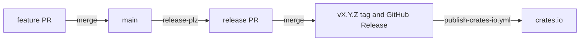

# Contributing to sas-plus

Thanks for helping out. This file explains how the repository is set up and what a change
needs before it can be merged.

## Setup

1. Install Rust via [rustup](https://rustup.rs/). Development uses current stable; the MSRV
   in `Cargo.toml` (`rust-version`) applies to the library, not to tests and benches.
2. Install [Task](https://taskfile.dev/installation/). All commands below go through it. Run
   `task` to list them.
3. Optional tools: the tasks tell you when one is missing.
   - [cargo-nextest](https://nexte.st/) for faster tests;
   - [cargo-deny](https://github.com/EmbarkStudios/cargo-deny) and
     [cargo-hack](https://github.com/taiki-e/cargo-hack);
   - [cargo-llvm-cov](https://github.com/taiki-e/cargo-llvm-cov) for coverage;
   - [typos](https://github.com/crate-ci/typos);
   - [mermaid-cli](https://github.com/mermaid-js/mermaid-cli) when changing diagrams;
   - [actionlint](https://github.com/rhysd/actionlint) and [zizmor](https://docs.zizmor.sh/);
   - nightly Rust plus [cargo-fuzz](https://github.com/rust-fuzz/cargo-fuzz) for fuzzing;
   - the `thumbv7em-none-eabihf` target (`rustup target add thumbv7em-none-eabihf`) and the
     MSRV toolchain for `task build:no-std` and `task msrv`;
   - Docker for `task ground`, which grounds PDDL with Fast Downward's translator.
4. Install the git hooks with [prek](https://prek.j178.dev/) (`prek install`), or with
   `pre-commit install`. Fast checks run on commit; clippy and tests run on push.

`Cargo.lock` is not tracked. The planning crates are developed side by side, and dependent
crates build against this working tree through an untracked `[patch.crates-io]` file in the
parent directory (`../.cargo/config.toml`), which rewrites lock files on every build. CI
resolves from crates.io.

## Everyday commands

| Command | What it does |
|---|---|
| `task test` | Tests (nextest if installed) and doctests |
| `task lint` | clippy (pedantic), separator ban, README link check, typos, workflow lints |
| `task fmt` | Format the code |
| `task doc` | Build the docs, private items included, with warnings as errors |
| `task ci` | Everything CI runs except the coverage upload and the semver check (`task coverage`, `task semver`). Run it before you open a PR |
| `task bench` | Benchmarks |
| `task test:prop` | Property tests with 10000 cases (`PROPTEST_CASES`) |
| `task build:no-std` | Build the library for a bare-metal target with default, no and all features |
| `task fuzz:smoke` | Run every fuzz target briefly (needs nightly) |
| `task fuzz` | Fuzz the `output.sas` reader for 5 minutes, seeded with the fixtures |
| `task ground:load` | Ground PDDL with Fast Downward (Docker) and load it with `examples/load.rs` |
| `task clean` | Remove build output (fuzz corpora and crash artifacts are kept) |

## Code style

- Every item has a doc comment, private items included.
- No `mod.rs`: use `foo.rs` plus `foo/`.
- No `// ----` separator comments. Split the file into modules instead.
- Keep functions small, and extract helpers with descriptive names.
- `clippy::pedantic` must pass. If a lint is wrong in one place, use
  `#[expect(lint, reason = "...")]` on that item. Never `#[allow]`.
- Unsafe code is forbidden unless a crate explicitly documents why it needs it.
- README and doc links use absolute URLs (crates.io renders READMEs outside GitHub).
  Mermaid diagrams are welcome.
- The library is `no_std` and needs only `alloc`.
- Files under `tests/fixtures/` are compared byte for byte. Do not reformat them. New
  third-party fixtures need their provenance in `tests/fixtures/translated/README.md` and an
  entry in `REUSE.toml`.

## Branches

This repository uses **GitHub Flow**:

- `main` is always releasable.
- Work happens on `feature/<topic>` branches. Bug fixes are feature branches too.
- Open a PR into `main`.

No other prefixes (`fix/`, `chore/`, `deps/`, ...). `task lint:branch`, the pre-push hook and
CI check the branch name. Bot branches (`release/*` from release-plz, `dependabot/*`) are the
only exceptions. Copilot's `copilot/*` branches are renamed to `feature/*` before anyone
works on them.

## Commits and pull requests

- Commit subjects use the **imperative mood**, like Git itself: "Add parser for pair lists",
  "Fix overflow in tile index". Do not write "Added ...", "Adds ..." or `feat: ...`.
- Keep the subject to 72 characters or fewer, capitalized, with no trailing period. Then add
  a blank line and a body that explains *why*. The `commit-msg` hook checks the subject.
- No co-author trailers, claude.ai/claude.com links or AI attribution in commit messages. The
  `commit-msg` and `pre-push` hooks reject them (`scripts/check-no-ai-attribution.sh`).
- The changelog groups commits by their leading verb (Add, Fix, Remove, Deprecate, ...).
  Write a `BREAKING CHANGE:` line in the body for incompatible changes.
- PRs are merged with a merge commit, or squashed using the PR title and description. Write
  both with care. Head branches are deleted after the merge.
- Keep PRs focused. CI must be green.
- Do not bump versions or edit `CHANGELOG.md` by hand. Releases are automated (see below).

## Releases

Versions follow [Semantic Versioning 2.0](https://semver.org/spec/v2.0.0.html), as Cargo
implements it (in `0.x`, a minor bump is breaking).

Releases are handled by [release-plz](https://release-plz.dev/). Every merge to
`main` updates a release PR. Merging that PR tags the release and creates the
GitHub Releases. The `vX.Y.Z` tag then triggers `publish-crates-io.yml`, which
publishes the crate to crates.io via trusted publishing from the protected `crates-io`
environment.

`publish-crates-io.yml` first checks that the tag is on `main` and reruns clippy, the tests,
the `no_std` builds and the MSRV build. Subjects starting with Add, Introduce, Support,
Allow, Implement or Expose are features; a `BREAKING CHANGE:` line in the body forces a
breaking bump, as does an API break found by `cargo-semver-checks`.

## License

By contributing, you agree that your contributions are licensed under MIT OR Apache-2.0, the same
terms as the project (CC0-1.0 for code under `examples/`). See the License section of the
README and `REUSE.toml`.
